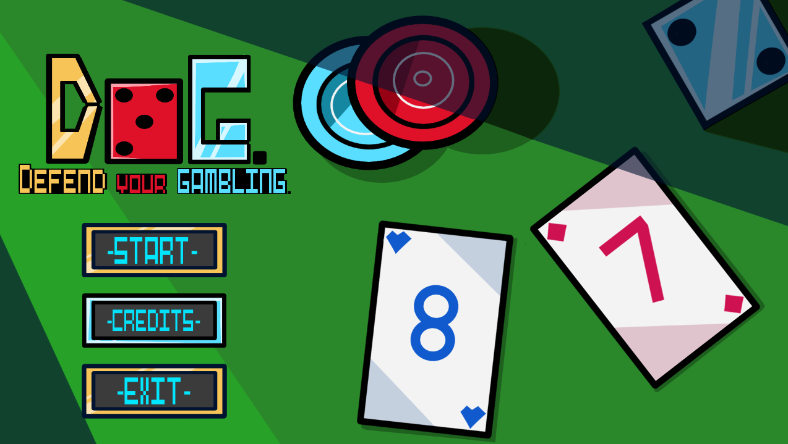
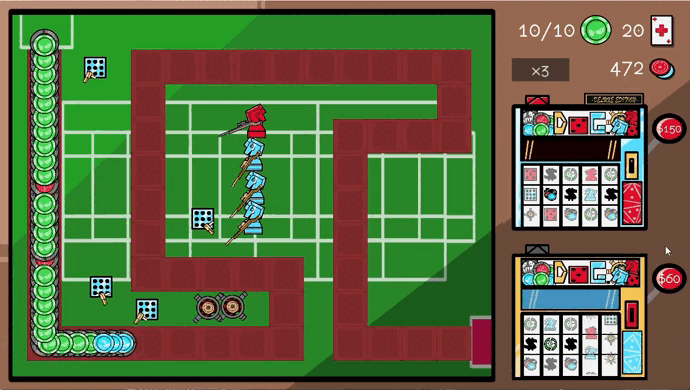

A Tower Defense game made for "The Very Serious Juniper Dev Game Jam".

It mixes the basic mechanics of a tower defense game, with tower placing and shooting, and waves of enemies that follow a path until the end where they do damage to you.
The main difference is the "Spin to Win" theme of the Jam, that we interpreted as a slot machine, so you need to bet on these machines to get the towers that you need to defend your base.
There are two tiers of machines, the first one gives you basic towers, with a small chance of upgrades, and the second tier has more probability to give you upgrades, with a small chance of normal ones. But both have a chance of giving you nothing at all, or even throw more enemies at you.

Aside from the towers there are 3 types of "prices", that you get if the machine rolled 3 or more of the same type. 3 is the basic, 4 is tier 2 and 5 is tier 3.

Money:
The basic one, gives you some amount of money, depending on how much you spent on the machine, and the tier of the price.
Kill enemies:
Kills a certain amount of enemies in your screen, ranging from 1/10 of them to everything in it, with the exception of the final boss.
More enemies:
Summones a small wave of enemies to add to the current one. The amount and type of enemies depends on the wave you are currently on.

Now for the tower types:
* Basic: Medium range, single bullet, medium speed, great damage.
* Sniper: Long range, single bullet, slow speed and damage.
* Multi shot: Small range, 4 bullets, medium speed and damage.

And each one with an upgrade available:
* Basic: Bigger range, more damage and pierces 3 enemies.
* Sinper: More speed and damage and pierces 2 enemies.
* Multi shot: 8 bullets, a bit more range and damage.

And for the enemies there are 4 types:
* Basic: Normal speed, medium health, deals 1 damage.
* Tank: Slow speed, high health, deals 2 damage.
* Speedy: Fast speed, low health, deals 1 damage.
* Final boss: Slow speed, a ton of health, insta kills.
